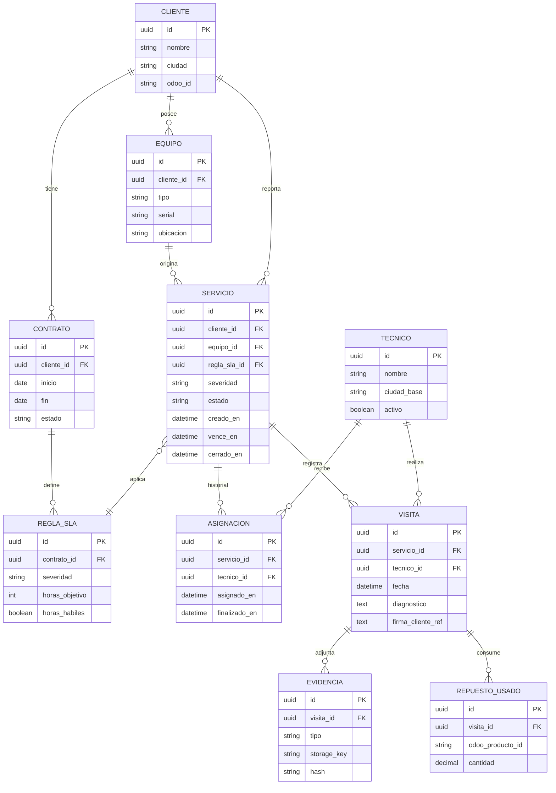
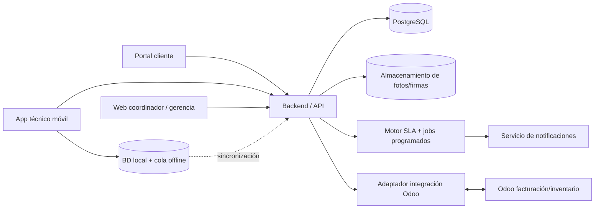

# Sección 3 — Análisis y diseño: TecnoFrío SAS

## 3.1 Levantamiento

1. **¿Cómo se define exactamente el inicio, pausa y cumplimiento del SLA y qué calendario laboral aplica por ciudad/contrato?** Cambia el motor de vencimientos: festivos, horarios, pausas por espera del cliente y diferencias contractuales alteran la fecha límite.
2. **¿Cómo se priorizan y reasignan técnicos (ciudad, especialidad, disponibilidad, carga, cercanía)?** Define si basta una asignación manual o se necesita un motor de recomendación/geolocalización.
3. **¿Qué datos del cliente, contrato, equipo y repuestos son maestros en Odoo y qué API/módulos están disponibles?** Determina qué información se replica, qué se consulta en tiempo real y el alcance de la integración.
4. **¿Qué conectividad real tienen los técnicos y qué operaciones deben funcionar sin señal?** Cambia la arquitectura móvil, almacenamiento local, sincronización, compresión de fotos y resolución de conflictos.
5. **¿Quién puede ver/editar cada servicio y qué evidencia legal debe conservarse (firma, fotos, auditoría)?** Define roles, permisos, trazabilidad, retención y controles de integridad.

## 3.2 Actores e historias de usuario

**Actores:** cliente/solicitante, coordinador de servicios, técnico de campo, gerente/supervisor y Odoo como sistema externo.

### Historias priorizadas
1. **P1 — Cliente:** Como cliente, quiero reportar una falla indicando equipo, severidad y evidencia para que TecnoFrío pueda atenderla dentro del SLA.
2. **P1 — Coordinador:** Como coordinador, quiero ver servicios pendientes y asignar/reasignar un técnico para organizar la operación de campo.
3. **P1 — Técnico:** Como técnico, quiero registrar diagnóstico, fotos, repuestos y firma desde el celular incluso sin señal para dejar evidencia completa de la visita.
4. **P2 — Gerencia:** Como gerente, quiero consultar cumplimiento de SLA por cliente, ciudad y técnico para identificar incumplimientos y mejorar la operación.

### Criterios de aceptación — Reportar falla
**Dado** un cliente autenticado con un contrato activo y un equipo registrado,  
**Cuando** crea un reporte con descripción y severidad,  
**Entonces** el sistema genera un número de servicio, calcula el vencimiento del SLA y muestra el estado inicial al cliente.

**Dado** que faltan datos obligatorios,  
**Cuando** el cliente intenta enviar el reporte,  
**Entonces** el sistema no lo crea e indica qué información debe completar.

### Criterios de aceptación — Registrar visita offline
**Dado** un técnico con un servicio previamente sincronizado y sin conectividad,  
**Cuando** registra diagnóstico, repuestos, fotos y firma y finaliza la visita,  
**Entonces** la información queda guardada localmente como pendiente de sincronización.

**Dado** que vuelve la conectividad,  
**Cuando** la aplicación sincroniza,  
**Entonces** envía las operaciones pendientes una sola vez, conserva las evidencias y confirma al técnico que quedaron registradas.

## 3.3 Modelo de datos

## 3.4 Arquitectura de alto nivel

### (a) SLA y alertas
Al crear el servicio se selecciona la regla del contrato y se calcula `vence_en` con un calendario de negocio configurable por ciudad/contrato. Como supuesto inicial, crítico (4 h) y alto (8 h) son horas corridas y normal (48 h) son hábiles, hasta confirmar la regla con TecnoFrío. Un job periódico busca casos abiertos próximos a vencer (por ejemplo 75% y 90% del tiempo consumido), emite alertas idempotentes y escala los vencidos.

No recalcularía el SLA leyendo reglas actuales cada vez: guardaría en el servicio la regla aplicada/plazo calculado para conservar trazabilidad aunque el contrato cambie después.

### (b) Técnico sin señal
La app es **offline-first** para los servicios ya sincronizados: guarda formularios y metadatos en una base local y fotos/firmas en almacenamiento local cifrado. Cada operación usa un UUID generado en el dispositivo y una cola de sincronización con reintentos; el backend procesa comandos de forma idempotente para evitar duplicados. Los conflictos de datos operativos sensibles (p. ej. servicio reasignado mientras el técnico estaba offline) se muestran al usuario en vez de sobrescribir silenciosamente.

## 3.5 Alcance

### MVP de 6 semanas
- Autenticación y roles básicos: cliente, coordinador, técnico y gerente.
- Alta/consulta de servicios, estados y cálculo de SLA.
- Asignación manual y reasignación de técnicos.
- App/PWA de técnico con diagnóstico, fotos, repuestos, firma y operación offline básica.
- Portal del cliente para crear solicitudes y consultar estado.
- Alertas esenciales de SLA por correo/notificación interna.
- Dashboard básico de cumplimiento por cliente, ciudad y técnico.
- Integración mínima con Odoo para consultar catálogo/existencia de repuestos y registrar el consumo acordado.

**Fuera del MVP:** optimización automática de rutas/asignaciones, geolocalización en tiempo real, analítica predictiva, chatbot/WhatsApp bidireccional, facturación automática compleja y BI avanzado.

### Riesgos y mitigación
1. **Integración Odoo más compleja o limitada de lo esperado.** Mitigar con un spike técnico en la primera semana, contrato de API/adapter aislado y mocks para que el resto del producto no dependa del avance de Odoo.
2. **Pérdida/duplicación de información offline y fotos pesadas.** Mitigar con persistencia local, UUID/idempotencia, sincronización reintentable, compresión/subida diferida, indicadores visibles de estado de sync y pruebas en condiciones reales de baja conectividad.
